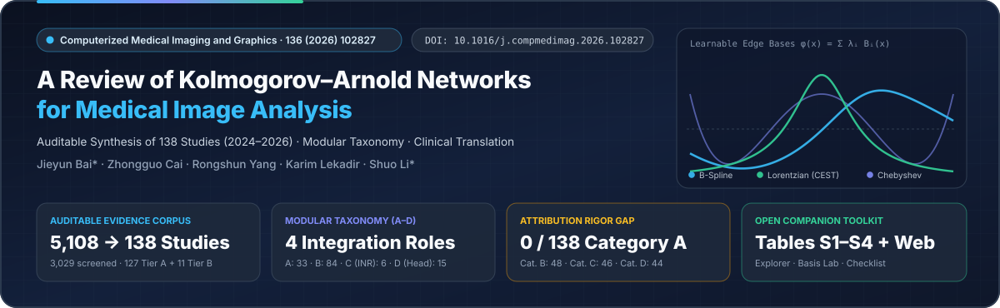
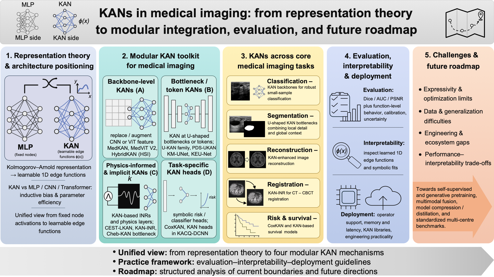
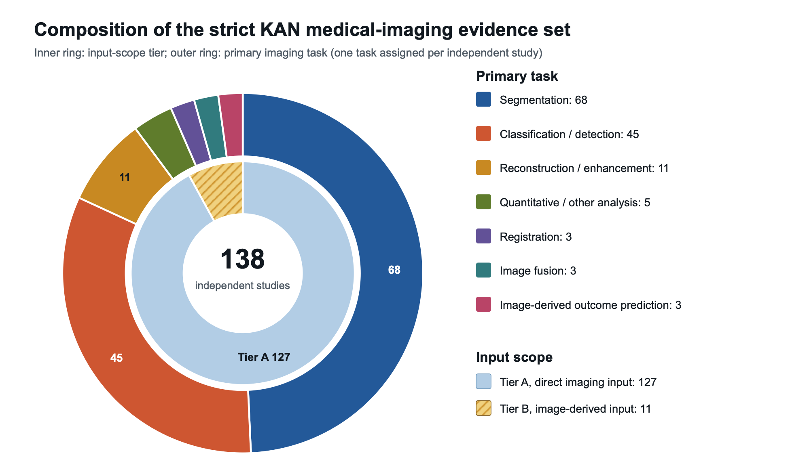
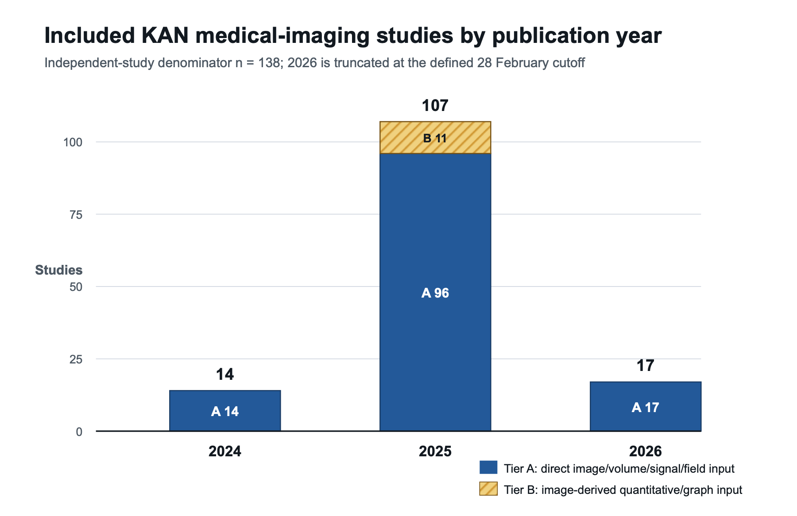
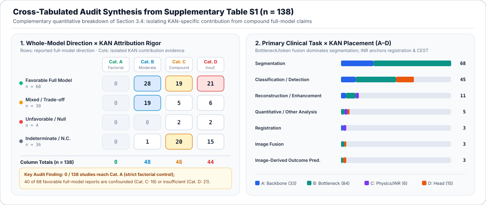
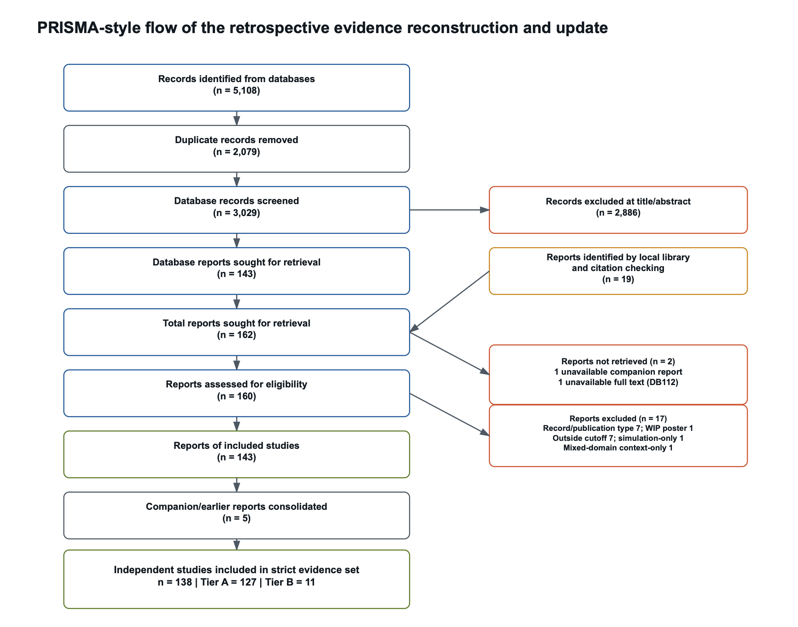
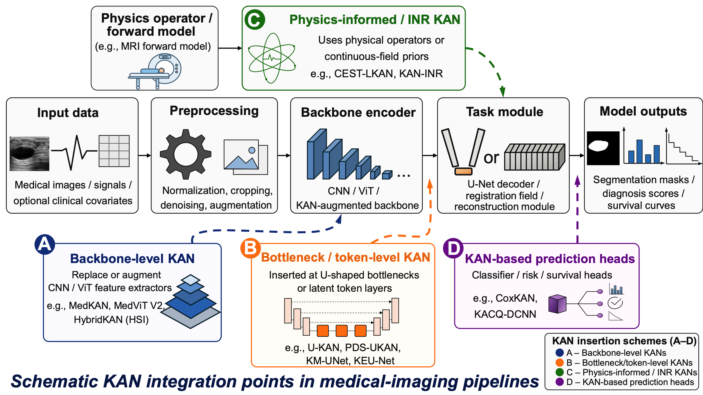
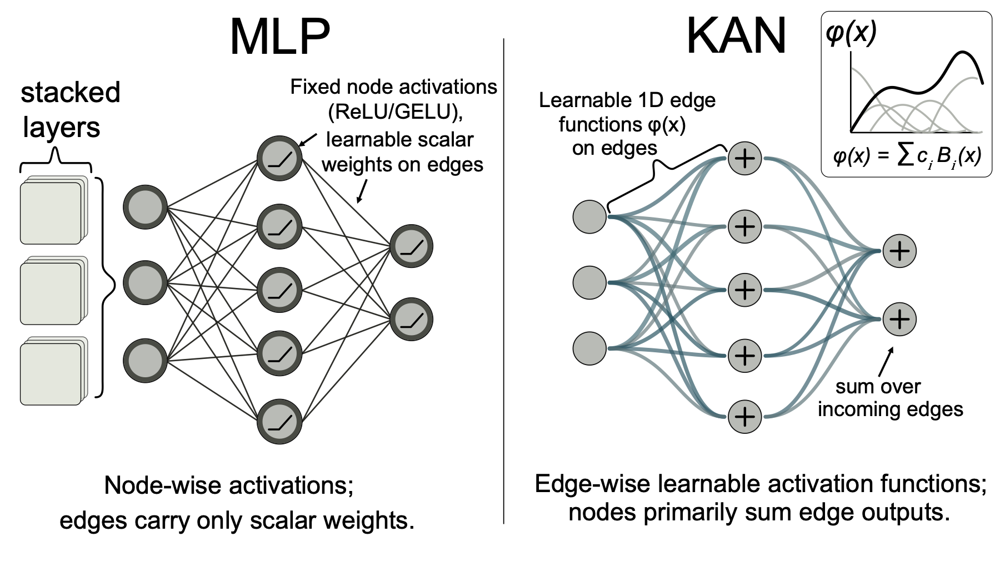
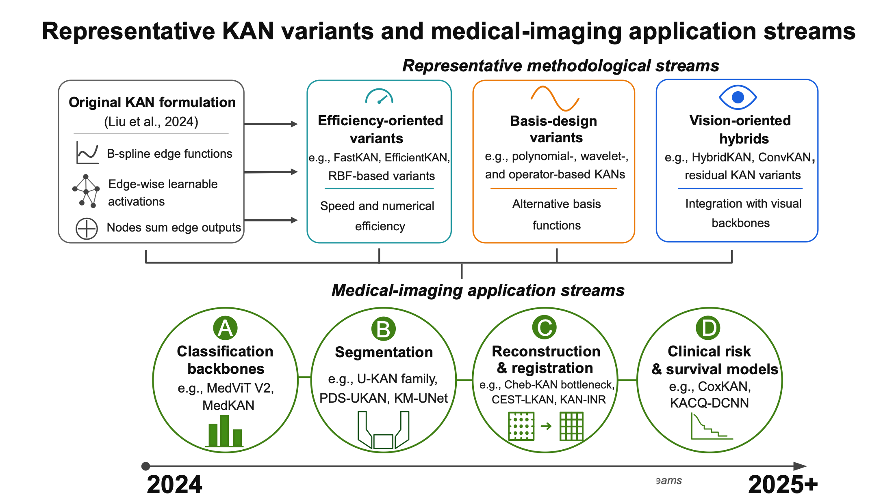
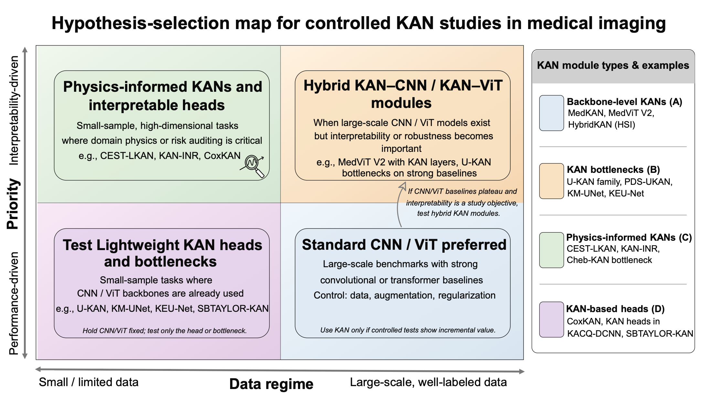

<div align="center">



<br />

[%20102827-0284c7?style=for-the-badge)](https://doi.org/10.1016/j.compmedimag.2026.102827)
[](https://doi.org/10.1016/j.compmedimag.2026.102827)
[](https://simon-tisa.github.io/KAN-Medical-Imaging-Review/)
[](docs/CATALOG_138_STUDIES.md)
[](data/)
[](LICENSE)

**English** · **[简体中文 (Chinese README)](README_zh.md)** · **[Launch Interactive Web Portal ↗](https://simon-tisa.github.io/KAN-Medical-Imaging-Review/)** · **[Complete 138-Study Catalog](docs/CATALOG_138_STUDIES.md)** · **[Data Dictionary (S1–S4)](data/README.md)** · **[Read the Paper (DOI)](https://doi.org/10.1016/j.compmedimag.2026.102827)**

</div>

---

## Overview

Official open-science companion repository for our methodological review published in ***Computerized Medical Imaging and Graphics***:

> **A review of Kolmogorov–Arnold networks for medical image analysis**  
> **Jieyun Bai**\*,<sup>1</sup>, **Zhongguo Cai**<sup>1</sup>, **Rongshun Yang**, **Karim Lekadir**, **Shuo Li**\*  
> *Computerized Medical Imaging and Graphics*, Volume 136, 2026, 102827  
> **DOI:** [https://doi.org/10.1016/j.compmedimag.2026.102827](https://doi.org/10.1016/j.compmedimag.2026.102827)

<div align="center">
  
  <p><em><strong>Fig. 4 (Overview):</strong> Five core pillars of this review—from representation theory and modular KAN integration (A–D) to task-level evidence, normative evaluation/interpretability/deployment criteria, and testable research priorities. Illustrative thumbnails adapted from public datasets BreastMNIST/MedMNIST (CC BY 4.0), BUSI (CC BY 4.0), and Brain Tumor MRI (CC0). Reproduced from Bai et al., Comput. Med. Imaging Graph. 136 (2026) 102827, © 2026 Elsevier Ltd.</em></p>
</div>

### Key Takeaways in 30 Seconds

- **Auditable Evidence Reconstruction (`5,108 → 138`)**: From `5,108` raw records across Crossref, Europe PMC, arXiv, and OpenAlex (`3,029` unique records screened in [`Table S4`](data/S4_title_abstract_screening_ledger.csv); `162` reports tracked in [`Table S2`](data/S2_report_level_screening_ledger.csv)), **`138` independent studies** met strict medical-imaging eligibility (`127` **Tier A** direct image/volume/signal inputs; `11` **Tier B** image-derived quantitative/graph representations).
- **Headline Claims ≠ Isolated KAN Effect**: While `68 / 138` studies reported favorable whole-model outcomes (`30` mixed/trade-off, `4` unfavorable/null, `36` indeterminate), **zero (`0 / 138`) satisfied Category A** (complete resource-controlled factorial comparison). Only `48` provided **Moderate (`Cat. B`)** KAN-specific evidence, while `46` were confounded by simultaneous attention/Mamba/loss co-modifications (**`Cat. C`**) and `44` lacked defensible attribution (**`Cat. D`**).
- **Bounded Module > Full Backbone Replacement**: Current empirical evidence supports KAN **chiefly as a task-dependent functional module** for controlled testing within established CNN, Transformer, state-space, or physics-informed pipelines—rather than as a universally superior replacement for mature backbones.
- **Inspectable Curves ≠ Clinical Explainability**: Learnable 1D edge functions provide *functional transparency*, but *model interpretability* and *clinical explainability* require empirical proof of numerical fidelity, multi-seed stability, calibration, and workflow utility.

---

## Interactive Companion Portal (`docs/`)

This repository ships with a **zero-dependency, bilingual (EN / 中文) interactive web portal** in [`docs/`](docs/index.html) ready for **GitHub Pages** or instant offline local use:

| Interactive Module | What Readers & Researchers Can Do |
| :--- | :--- |
| **1. Click-to-Filter Evidence Matrices** | Click any cell in the *Whole-Model Direction × KAN Attribution* matrix or *Task × Placement (A–D)* heatmap to inspect the exact underlying studies. |
| **2. 138-Study Auditable Explorer** | Multi-dimensional filtering across **Task**, **KAN Placement (A–D)**, **Evidence Grade (B/C/D)**, **Direction**, **Imaging Modality** (MRI, CT, US, Pathology, Endoscopy, OCT, etc.), and **Year/Tier**, with full audit-card inspection and **CSV / JSON subset export**. |
| **3. KAN Edge-Basis & Physics Sandbox** | Live mathematical plotter comparing MLP node activations (`ReLU`, `SiLU`, `GELU`) against **B-Spline** (`U-KAN`), **Lorentzian** (`CEST-LKAN`), **Chebyshev** (`Cheb-KAN`), **Jacobi** (`KAN-INR`), and **Gaussian RBF** (`FastKAN`) edge bases, plus an interactive $\mathcal{O}(Lw^2)$ vs. $\mathcal{O}(Lw^2(G+p))$ parameter estimator. |
| **4. Study Designer & Reporting Checklist** | Interactive **Hypothesis-Selection Advisor** (operationalizing Fig. 8) + **16-item Minimum Reporting Checklist Generator** (Section 4.4) that exports a ready-to-paste **Markdown reproducibility table** for new manuscripts and rebuttals. |

```bash
# Preview locally without any build step or package installation:
open docs/index.html
# Or serve over HTTP:
python3 -m http.server 8000 -d docs
```

> **Enable on GitHub Pages**: After pushing to GitHub, go to **Settings → Pages → Build and deployment**, and select either **GitHub Actions** (pre-configured in [`.github/workflows/pages.yml`](.github/workflows/pages.yml)) or **Deploy from a branch (`main` / `/docs`)**.

---

## 1. Evidence Reconstruction & Quantitative Synthesis (`n = 138`)

<table>
  <tr>
    <td width="52%" align="center">
      
      <br /><sub><strong>Fig. 3:</strong> Inner ring: input-scope tiers (Tier A 127, Tier B 11); outer ring: primary medical imaging tasks.</sub>
    </td>
    <td width="48%" align="center">
      
      <br /><sub><strong>Fig. 2:</strong> First eligible public report year (2024: 14, 2025: 107, 2026 through Feb 28: 17).</sub>
    </td>
  </tr>
</table>

<div align="center">
  
</div>

<details>
<summary><strong>Click to expand Fig. 1 — Complete PRISMA-Style Retrospective Evidence Reconstruction Flow (5,108 → 138)</strong></summary>
<br />
<div align="center">
  
</div>
</details>

### Two-Axis Evidence Evaluation Rules

To prevent favorable full-model metrics from being misread as causal proof that KAN caused the gain, every study in [`data/S1_study_level_evidence_matrix.csv`](data/S1_study_level_evidence_matrix.csv) is coded along **two orthogonal axes**:

| KAN-Specific Contribution Evidence | Count | Operational Criterion |
| :--- | :---: | :--- |
| **Category A — Strong** | **`0`** | Factorial or strictly parameter- & compute-matched repeated comparison isolating the KAN component. |
| **Category B — Moderate** | **`48`** | Matched component replacement or focused KAN removal ablation within the same host scaffold (incomplete budget matching permitted). |
| **Category C — Weak / Compound** | **`46`** | KAN introduced alongside material co-modifications (attention, Mamba/SSM blocks, multiscale fusion, or loss changes) without isolating KAN. |
| **Category D — Insufficient** | **`44`** | No defensible KAN-specific contrast recoverable, non-equivalent baselines, or unresolved reporting inconsistencies. |

---

## 2. Foundations & Four Modular Integration Paradigms (`A–D`)

<div align="center">
  
  <p><em><strong>Fig. 7:</strong> Schematic insertion points (A–D) of KAN modules across an end-to-end medical-imaging pipeline.</em></p>
</div>

<table>
  <tr>
    <td width="46%" align="center">
      
      <br /><sub><strong>Fig. 5:</strong> Node-wise fixed activations (MLP) vs. edge-wise learnable 1D basis functions φ(x) (KAN).</sub>
    </td>
    <td width="54%" align="center">
      
      <br /><sub><strong>Fig. 6:</strong> Methodological streams (efficiency, basis design, vision hybrids) bridging to medical application streams A–D.</sub>
    </td>
  </tr>
</table>

| Code | Modular Integration Mechanism | Studies (`n=138`) | Dominant Medical Tasks | Representative Architectures | Primary Methodological Caution |
| :---: | :--- | :---: | :--- | :--- | :--- |
| **A** | **Backbone-Level Fusion** | `33` (`23.9%`) | Segmentation (`20`), Classification (`9`), Recon (`3`), Reg (`1`) | `MedViT V2`, `MedKAN`, `KACNet`, `MSFKAN`, `DEQ-KAN`, `GhostKMNet` | Repeated high-res basis evaluations inflate memory/latency; requires compute-matched controls. |
| **B** | **Bottleneck / Token-Level Fusion** | `84` (`60.9%`) | Segmentation (`48`), Classification (`25`), Recon (`6`), Other (`5`) | `U-KAN`, `KM-UNet`, `KEU-Net`, `UKAN-EP`, `MedVKAN`, `Semi-KAN`, `UNETVL` | Most tractable testbed, but compound Mamba/attention hybrids must ablate KAN separately. |
| **C** | **Physics-Informed & INR Modules** | `6` (`4.3%`) | Registration (`2`), Recon (`2`), CEST Quantification (`2`) | `CEST-LKAN`, `KAN-INR`, `KAN-IDIR`, `TC-KANRecon`, `Chebyshev-KAN` | Test domain-specific bases (e.g., Lorentzian/Jacobi) against both generic splines and MLP-INRs. |
| **D** | **Task-Specific Functional Heads** | `15` (`10.9%`) | Classification (`11`), Outcome/Survival (`2`), Fusion/Quant (`2`) | `CoxKAN`, `SBTAYLOR-KAN`, `KACQ-DCNN` | Symbolic/edge curves on latent features are hypothesis-generating, not clinically validated explanations. |

👉 **Browse all 138 studies with clickable DOIs/arXiv links, modalities, directions, and evidence grades in [`docs/CATALOG_138_STUDIES.md`](docs/CATALOG_138_STUDIES.md).**

---

## 3. Experimental Design & Normative Reporting Framework

<div align="center">
  
  <p><em><strong>Fig. 8:</strong> Hypothesis-selection map guiding controlled study design and baseline selection across data regimes and transparency priorities.</em></p>
</div>

### Four-Part Minimum Reporting Standard for Future Medical-Imaging KAN Studies

1. **Data & Patient-Level Task Performance**: Disclose patient, volume/image, and center counts; enforce patient-level splits; report uncertainty intervals (multi-seed SD or CIs); include external-center validation when claiming generalization.
2. **Isolated KAN-Specific Contribution**: Include a fixed-activation control (`MLP`/`CNN`) and a KAN-only replacement under matched channels, depth, training schedule, and parameter/FLOP budgets; report basis family, grid/knots $G$, order $p$, initialization, and regularization.
3. **Reliability, Calibration & Curve Stability**: Report a proper scoring rule (Brier score) + Expected Calibration Error (`ECE`); evaluate uncertainty against observed errors; test extracted edge curves or symbolic formulas for numerical fidelity and cross-seed stability.
4. **Hardware Resources & Reproducibility**: Separate trainable parameters, FLOPs/MACs, peak training/inference VRAM, and warmed-up latency/throughput on specified hardware and numerical precision; release code, split manifests, and seeds.

---

## Repository Structure & Reproducibility

```text
├── README.md                        # English flagship documentation
├── README_zh.md                     # Chinese companion documentation (中文版说明)
├── CITATION.cff                     # Native GitHub "Cite this repository" metadata
├── assets/
│   ├── paper_figures/               # High-DPI Retina PNGs rendered from original vector figures (Figs. 1–8)
│   └── figures/                     # GitHub banner & complementary Table S1 cross-tabulation SVGs
├── data/                            # Extracted auditable supplementary ledgers (Tables S1–S4)
│   ├── README.md                    # Column-level codebook for S1–S4
│   ├── S1_study_level_evidence_matrix.csv        # 138 independent studies (25 fields)
│   ├── S2_report_level_screening_ledger.csv      # 162 full-text/report audit decisions
│   ├── S3_exact_search_strategies.csv            # 7 reproducible API queries (5,108 records)
│   └── S4_title_abstract_screening_ledger.csv    # 3,029 unique records screened at T/A
├── docs/                            # Zero-dependency GitHub Pages interactive portal
│   ├── index.html                   # Bilingual (EN/中文) interactive web application
│   ├── CATALOG_138_STUDIES.md       # Complete Markdown index of all 138 included studies
│   └── assets/                      # Self-contained CSS, vanilla JS, figures, and built JSON/JS data
└── scripts/                         # Zero-dependency build pipeline
    ├── build_portal_data.py         # Builds docs/assets/data/* and CATALOG_138_STUDIES.md
    ├── render_paper_figures.py      # Renders vector PDFs -> high-DPI PNGs via macOS PDFKit
    ├── generate_figures.py          # Generates GitHub banner & Table S1 cross-tabulation SVGs
    └── build_all.py                 # One-command rebuild of all data and figures
```

```bash
python3 scripts/build_all.py
```

---

## Citation

If this review, modular taxonomy, auditable evidence matrix (`S1–S4`), or reporting checklist is useful for your research, please cite our paper:

```bibtex
@article{bai2026kan_review,
  title   = {A review of {Kolmogorov--Arnold} networks for medical image analysis},
  author  = {Bai, Jieyun and Cai, Zhongguo and Yang, Rongshun and Lekadir, Karim and Li, Shuo},
  journal = {Computerized Medical Imaging and Graphics},
  volume  = {136},
  pages   = {102827},
  year    = {2026},
  issn    = {0895-6111},
  doi     = {10.1016/j.compmedimag.2026.102827},
  url     = {https://doi.org/10.1016/j.compmedimag.2026.102827}
}
```

---

## Acknowledgments & Rights Notice

Supported by the National Natural Science Foundation of China (Grant No. `62671274`), the Natural Science Foundation of Guangdong Province (`2025A1515220071`), the Guangzhou Science and Technology Planning Project (`2025B03J0127`), and the European Research Council (ERC) under the Horizon Europe AIMIX Project (Grant Agreement No. `101044779`).

- **License & Copyright Scope**: Portal source code, scripts, and custom SVG charts are released under the [MIT License](LICENSE). Underlying screening and evidence ledgers (`data/S1–S4`) are shared openly in accordance with the article's Data Availability statement. Article figures in `assets/paper_figures/` (`Figs. 1–8`) are reproduced from [Bai et al., *Computerized Medical Imaging and Graphics* 136 (2026) 102827](https://doi.org/10.1016/j.compmedimag.2026.102827) (`© 2026 Published by Elsevier Ltd. All rights reserved.`) for non-commercial scholarly introduction and are **excluded** from the MIT License; illustrative public-dataset thumbnails in Figs. 4 & 7 credit BreastMNIST/MedMNIST (Yang et al., 2023, CC BY 4.0), BUSI (Al-Dhabyani et al., 2020, CC BY 4.0), and Brain Tumor MRI (Bhuvaji et al., 2020, CC0).
- **Correspondence**: Please refer to the [official ScienceDirect article page](https://doi.org/10.1016/j.compmedimag.2026.102827) for corresponding author contact details.
