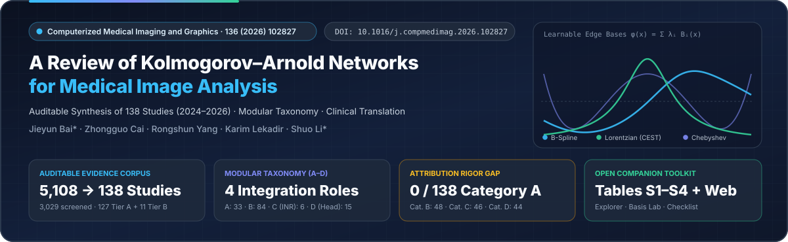
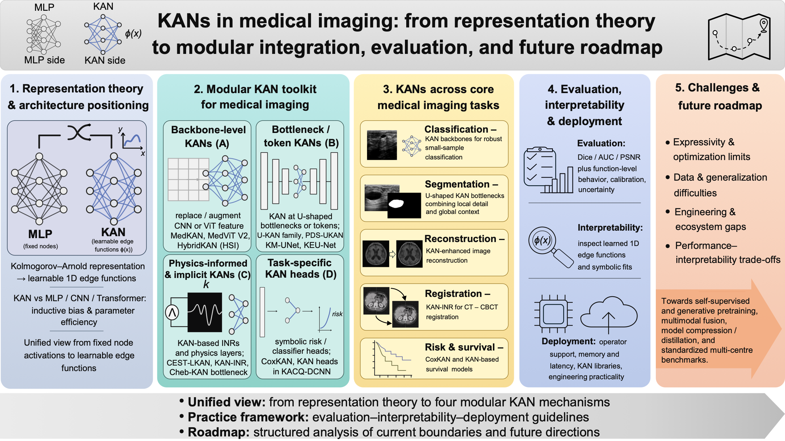
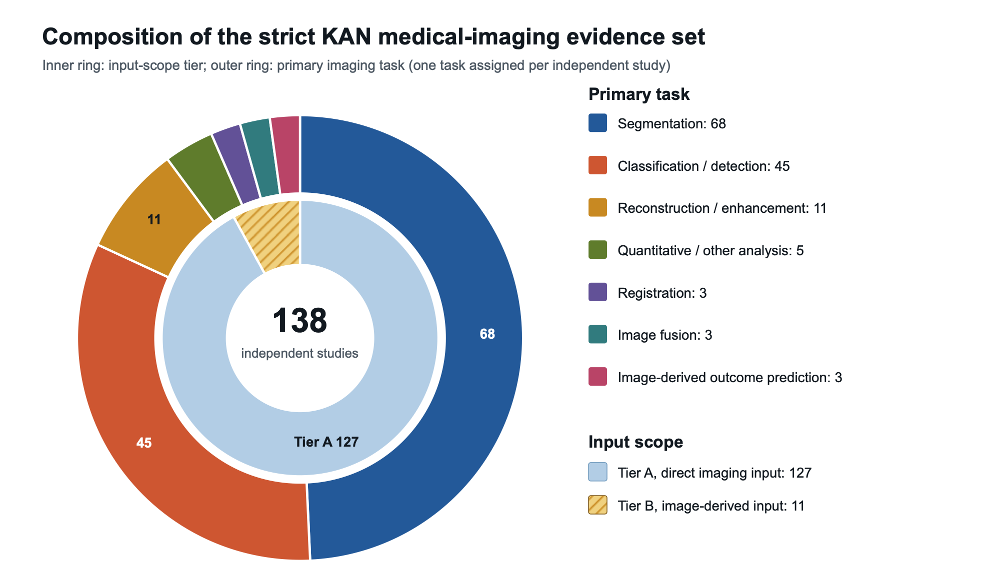
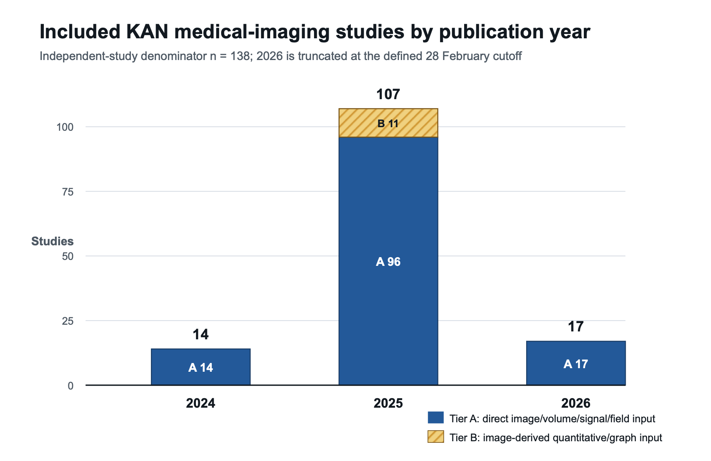
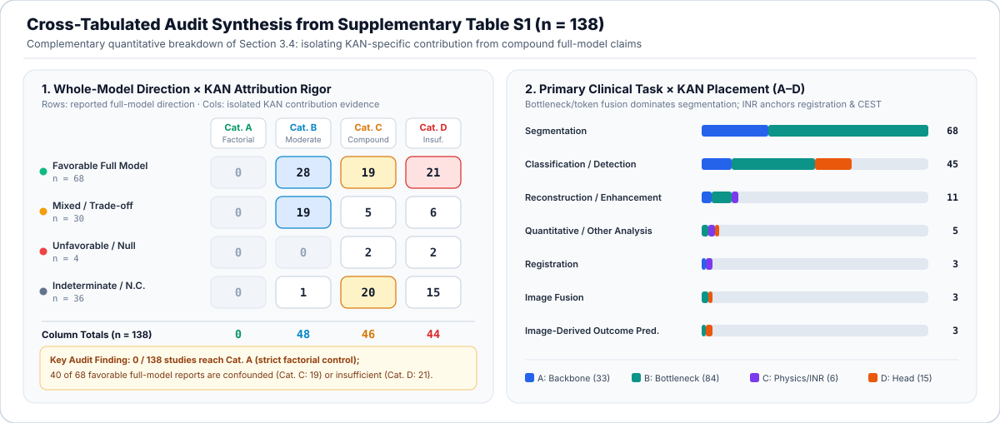
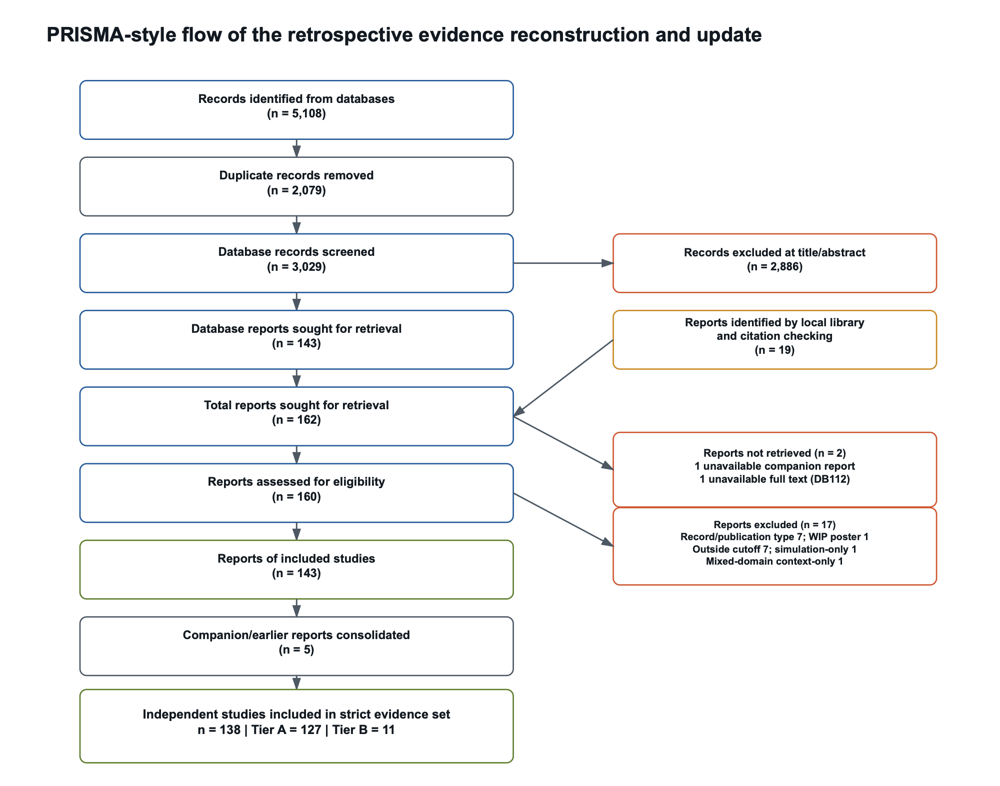
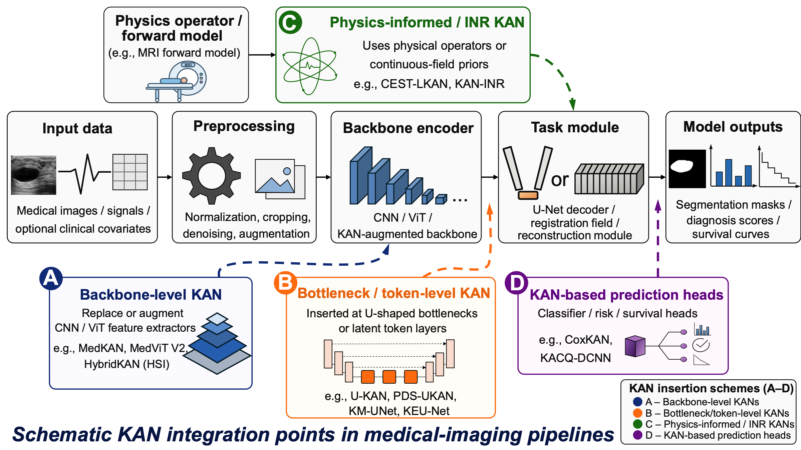
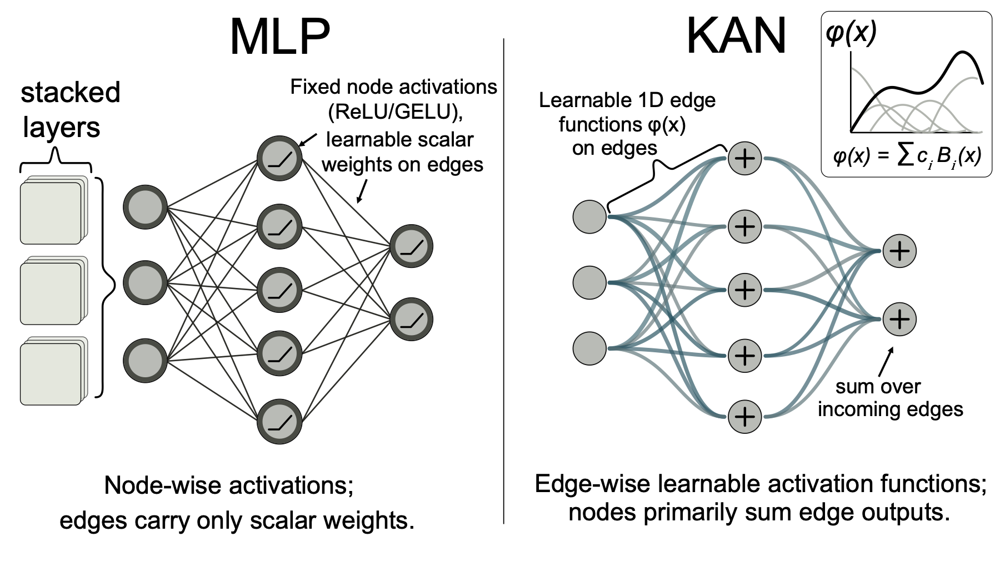
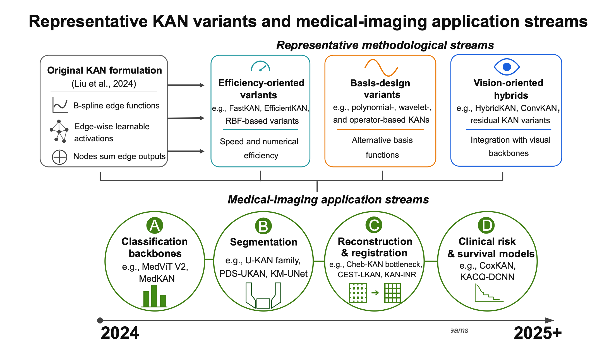
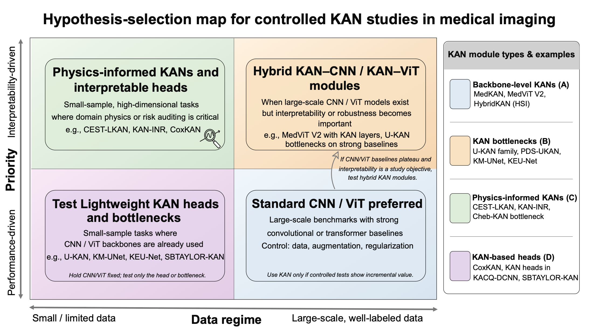

<div align="center">



<br />

[%20102827-0284c7?style=for-the-badge)](https://doi.org/10.1016/j.compmedimag.2026.102827)
[](https://doi.org/10.1016/j.compmedimag.2026.102827)
[](https://simon-tisa.github.io/KAN-Medical-Imaging-Review/)
[](docs/CATALOG_138_STUDIES.md)
[](data/)
[](LICENSE)

**[English README](README.md)** · **简体中文** · **[打开在线交互式门户 ↗](https://simon-tisa.github.io/KAN-Medical-Imaging-Review/)** · **[138 篇完整研究索引](docs/CATALOG_138_STUDIES.md)** · **[补充数据字典 (S1–S4)](data/README.md)** · **[阅读期刊原文 (DOI)](https://doi.org/10.1016/j.compmedimag.2026.102827)**

</div>

---

## 项目简介

本仓库是我们发表于医学图像分析权威期刊 ***Computerized Medical Imaging and Graphics* (CMIG, 2026)** 综述论文的官方开源学术门户与可复现证据工具箱：

> **A review of Kolmogorov–Arnold networks for medical image analysis**  
> （医学图像分析中的 Kolmogorov–Arnold 网络综述）  
> **Jieyun Bai**\*,<sup>1</sup>, **Zhongguo Cai**<sup>1</sup>, **Rongshun Yang**, **Karim Lekadir**, **Shuo Li**\*  
> *Computerized Medical Imaging and Graphics*, Volume 136, 2026, 102827  
> **DOI:** [https://doi.org/10.1016/j.compmedimag.2026.102827](https://doi.org/10.1016/j.compmedimag.2026.102827)

<div align="center">
  
  <p><em><strong>论文原图 Fig. 4（研究全景框架）：</strong>从表示理论与架构定位、模块化 KAN 工具箱（A–D）、核心医学影像任务应用，到评估/可解释性/部署规范与未来可检验研究方向。</em></p>
</div>

### 30 秒速览核心结论

1. **全链路可审计证据重构（`5,108 → 138`）**：系统检索 Crossref、Europe PMC、arXiv 与 OpenAlex 共 `5,108` 条记录，两轮去重后对 `3,029` 条记录逐一完成题录初筛（[`表 S4`](data/S4_title_abstract_screening_ledger.csv)），追踪评估 `162` 份报告（[`表 S2`](data/S2_report_level_screening_ledger.csv)），最终合并同实验多版本后纳入 **`138` 项独立医学影像研究**（其中 **Tier A 直接影像/体数据/信号输入 `127` 项**，**Tier B 医学影像显式派生定量/图表示 `11` 项**）。
2. **表面报喜 ≠ KAN 独立贡献（核心发现）**：在 `138` 项研究中，虽有 `68` 项报告全模型优于主对比基线（另有 `30` 项混合/折中、`4` 项无增益/劣于基线、`36` 项不可比），但 **没有任何一项（`0 / 138`）满足最严格的 A 级完整预算匹配析因归因标准**！仅 `48` 项提供了 **B 级中等独立证据**，而 `46` 项同时叠加了注意力、Mamba 状态空间块或多尺度融合等混杂改动（**C 级弱/复合证据**），`44` 项归因证据不足（**D 级**）。
3. **局部受控模块 > 盲目替换成熟主干**：现有证据表明，KAN 更适合作为**任务条件化的有界功能模块**嵌入成熟的 CNN、Transformer、Mamba 或物理驱动管线中进行受控测试，而非直接全面取代优化成熟的视觉主干网络。
4. **函数可观察 ≠ 临床可解释**：KAN 的一维可学习边函数提供了**结构级函数透明性（Functional transparency）**，但要上升为**模型可解释性**与**临床可解释性**，仍需严格的数值保真度、跨随机种子稳定性、概率校准及临床医生工作流验证。

---

## 交互式可视化门户 (`docs/`)

仓库内置了一套**纯静态、零外部依赖、支持中英双语与深浅色主题一键切换**的交互式学术门户（位于 [`docs/index.html`](docs/index.html)），推送至 GitHub 后即可通过 **GitHub Pages** 免服务器在线访问：

| 交互模块 | 核心功能亮点 |
| :--- | :--- |
| **1. 二维证据矩阵联动看板** | 点击“全模型结果方向 × KAN 独立归因等级”矩阵或“医学任务 × A–D 模块位置”表格中的任意数字，自动联动跳转查看对应文献。 |
| **2. 138 篇证据库多维浏览器** | 支持按**任务、A–D 嵌入位置、KAN 证据等级（B/C/D）、结果方向、成像模态（MRI/CT/超声/病理/内镜/OCT 等）、年份**组合筛选与全文搜索，弹窗查阅审稿级局限性剖析，并支持**导出 CSV / JSON 子集**。 |
| **3. KAN 边函数与物理先验沙盒** | 实时绘制并对比 MLP 节点激活与 5 类代表性 KAN 边基函数：**B-Spline**（`U-KAN`）、**Lorentzian 洛伦兹谱线**（`CEST-LKAN`）、**Chebyshev 多项式**（`Cheb-KAN` MRI 去伪影）、**Jacobi 多项式**（`KAN-INR` 4D 配准）与 **Gaussian RBF**（`FastKAN`），内置参数复杂度估算器。 |
| **4. 实验选型向导 & 自查表导出** | 将论文 **图 8（假设选择象限图）** 与 **第 4.4 节（四部分最低报告规范）** 做成交互式自查工具，实时预估实验可达到的证据等级（Cat. A–D），并**一键复制/下载自带引用的 Markdown 审稿自查表**。 |

```bash
# 本地零配置直接预览（支持双击打开或本地静态服务）：
open docs/index.html
# 或启动本地 HTTP 服务：
python3 -m http.server 8000 -d docs
```

---

## 1. 证据重构与 138 项独立研究定量统计

<table>
  <tr>
    <td width="52%" align="center">
      
      <br /><sub><strong>论文原图 Fig. 3：</strong>内环为输入层级（Tier A: 127, Tier B: 11），外环为 7 类核心医学图像分析任务分布。</sub>
    </td>
    <td width="48%" align="center">
      
      <br /><sub><strong>论文原图 Fig. 2：</strong>138 项独立研究首次公开报告年份分布（2026 年截至 2 月 28 日检索窗口）。</sub>
    </td>
  </tr>
</table>

<div align="center">
  
</div>

<details>
<summary><strong>点击展开论文原图 Fig. 1 — PRISMA 回顾性证据重构与筛选全流程图（5,108 → 138）</strong></summary>
<br />
<div align="center">
  
</div>
</details>

---

## 2. 理论基础与四大 KAN 模块化集成机制（`A–D`）

<div align="center">
  
  <p><em><strong>论文原图 Fig. 7：</strong>端到端医学影像分析管线中的四类典型 KAN 插入位置（机制 A–D）。</em></p>
</div>

<table>
  <tr>
    <td width="46%" align="center">
      
      <br /><sub><strong>论文原图 Fig. 5：</strong>传统 MLP（节点固定激活+边标量权重）与 KAN（边可学习一维函数 φ(x)）对比。</sub>
    </td>
    <td width="54%" align="center">
      
      <br /><sub><strong>论文原图 Fig. 6：</strong>从效率优化、基函数设计与视觉混合变体到四大医学影像应用流。</sub>
    </td>
  </tr>
</table>

- **机制 A — 骨干级融合 (`n = 33`, `23.9%`)**：在主干编码器中重复堆叠 KANConv 或 KAN 注意力层（如 `MedViT V2`、`MedKAN`、`KACNet`、`DEQ-KAN`）。高分辨率阶段重复求值基函数开销较大，需严格匹配参数与算力预算。
- **机制 B — 瓶颈 / Token 级融合 (`n = 84`, `60.9%`)**：保留成熟卷积/ViT/Mamba 编码器，仅在 U 型网络低分辨率瓶颈层、跳跃融合或潜在 Token 处嵌入 KAN（如 `U-KAN`、`KM-UNet`、`KEU-Net`、`UKAN-EP`、`Semi-KAN`）。目前在医学图像分割中最为主流，最易于做单模块替换消融。
- **机制 C — 物理先验与隐式神经表征模块 (`n = 6`, `4.3%`)**：在已知物理前向算子或连续形变速度场中引入领域匹配的基函数（如 `CEST-LKAN` 洛伦兹谱线拟合、`KAN-INR` / `KAN-IDIR` 配准、`TC-KANRecon` 重建）。需同时设置通用样条基与固定激活 MLP-INR 双重对照。
- **机制 D — 任务特定函数预测头 (`n = 15`, `10.9%`)**：保留成熟骨干提取特征，仅将末端分类、回归或生存风险层替换为轻量 KAN 头（如 `CoxKAN`、`SBTAYLOR-KAN`、`KACQ-DCNN`）。提取出的符号风险公式必须经过跨种子稳定性与外部中心验证。

👉 **点击查看按 A–D 分类整理、带 DOI/arXiv 直达链接的 [`138 篇完整研究目录 (CATALOG_138_STUDIES.md)`](docs/CATALOG_138_STUDIES.md)。**

---

## 3. 受控实验假设选择图与四维最低报告规范

<div align="center">
  
  <p><em><strong>论文原图 Fig. 8：</strong>面向不同数据规模与函数透明性需求象限的 KAN 模块选型与受控基线设计图。</em></p>
</div>

为推动后续医学影像 KAN 研究走向可复现、可归因与临床可转化，我们在第 4.4 节提出了**四部分最低报告规范**（可在交互式网页中直接勾选导出）：
1. **数据与患者级任务指标**：披露患者/影像/中心数，严格按患者划分数据集，报告不确定性区间及跨中心外部验证。
2. **隔离的 KAN 独立贡献证据**：在完全相同的宿主网络内提供固定激活对照与单一变量 KAN 消融，尽量匹配参数与 FLOPs 预算，完整披露基函数族、网格数 $G$、阶数 $p$、初始化与正则化。
3. **可靠性、校准与曲线稳定性**：报告 Brier 分数与 ECE 校准误差，检验不确定性与错误率关联，量化边函数曲线或符号公式跨随机种子的稳定性。
4. **硬件资源与可复现性**：分别报告参数量、FLOPs、峰值显存（VRAM）、预热后推理延迟与吞吐量，说明硬件/精度并开源代码与划分清单。

---

## 数据与图表一键构建

```bash
python3 scripts/build_all.py
```

---

## 引用方式 (Citation)

```bibtex
@article{bai2026kan_review,
  title   = {A review of {Kolmogorov--Arnold} networks for medical image analysis},
  author  = {Bai, Jieyun and Cai, Zhongguo and Yang, Rongshun and Lekadir, Karim and Li, Shuo},
  journal = {Computerized Medical Imaging and Graphics},
  volume  = {136},
  pages   = {102827},
  year    = {2026},
  issn    = {0895-6111},
  doi     = {10.1016/j.compmedimag.2026.102827},
  url     = {https://doi.org/10.1016/j.compmedimag.2026.102827}
}
```
